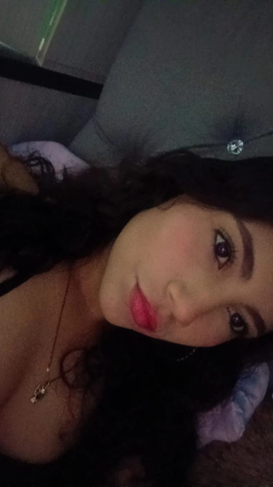

# ¡Hola! 👋 Soy Diana María Ariza Reyes

🎓 Estudiante de **Ingeniería de Sistemas**.

💻 Me interesa aprender programación, desarrollar proyectos y explorar nuevas tecnologías.

## 🚀 Sobre mí

- 🌱 Actualmente estoy aprendiendo programación.
- 🐍 Estoy comenzando con Python y explorando otros lenguajes.
- 📚 Me gusta aprender cosas nuevas y desarrollar mis habilidades.
- 🎯 Mi objetivo es crecer como desarrolladora y crear proyectos interesantes.

## 🛠️ Tecnologías que estoy aprendiendo

- Python
- Java
- Kotlin
- Git y GitHub

## 📫 Conecta conmigo

- GitHub: dariza633@unab.edu.co

---

⭐ *Gracias por visitar mi perfil.*
